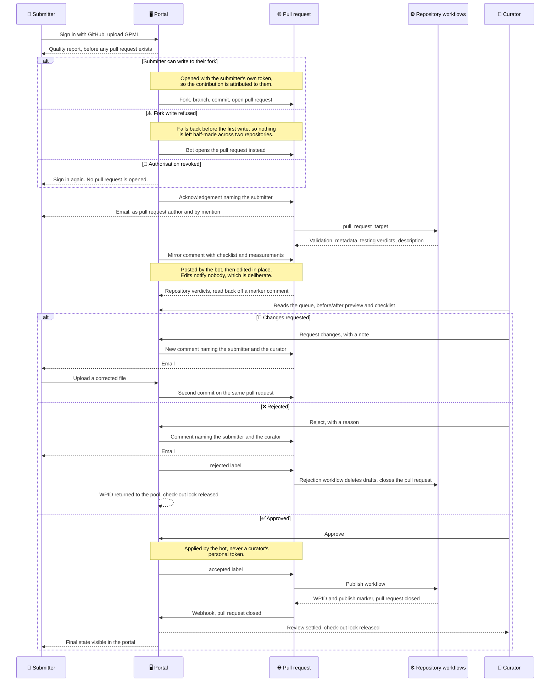

# Curation Portal

A web app that is the front door for **submitting and reviewing WikiPathways pathways** now that
all content lives on GitHub. A submitter uploads a GPML file in the browser and the portal opens a
real pull request against the content repository for them; nobody has to run git. Curators get a
queue and a review page for every pull request that touches a pathway: a before/after render, a
diff of what changed, a graded quality report, a checklist, the pull request's conversation and an
Approve button.

**Status: deployed for testing, not yet in production.** It runs at
[curation.wikipathways.org](https://curation.wikipathways.org) (the older
`upload.wikipathways.org` still answers) against the org's sandbox,
[`wikipathways/sandbox-wp-db`](https://github.com/wikipathways/sandbox-wp-db), where submit,
revise, update, review, approve and publish have all run end to end against live GitHub,
including from contributors' own forks. It has no announced users. What stands between it and
[`wikipathways/wikipathways-database`](https://github.com/wikipathways/wikipathways-database) is
listed in [`docs/production-readiness.md`](docs/production-readiness.md).

Licensed under [Apache-2.0](LICENSE). That covers the **code**; WikiPathways pathway content is
published separately under CC0.

## Why

The raw GitHub pull request flow serves neither submitters nor curators. A three-month audit of
51 pull requests ([`docs/design-proposal.md`](docs/design-proposal.md)) found submissions arriving
malformed (no WPID, wrong file names), concurrent GPML edits that cannot be merged, WPIDs colliding
across open pull requests, and curators asked to approve XML they cannot read because the rendered
diagram and tables were only generated after merge.

## What it does

**For submitters** (anyone, signed in with GitHub):

- **Submit** a new pathway or **update** an existing one. The portal lays out the files, opens the
  pull request from the submitter's own fork (the GitHub App's account when a fork cannot be
  used), and reports problems before the pull request exists.
- **Revise** a submission a curator sent back; the new file lands on the same pull request.
- One editor per pathway at a time (a check-out lock), so two updates of the same GPML never meet.

**For curators** (a configured list, optionally plus a GitHub team):

- A **queue** of every review, with name, organism, age and assignee, and an "Assigned to me" tab.
- A **review page**: the before/after diagram drawn by the portal itself, what changed (data
  nodes, title, description, references, ontology tags), the quality report, the content
  repository's own verdicts, the database's existing report on the pathway being edited, a
  checklist, the GitHub conversation with a comment box, and a history of who did what.
- **Approve, request changes or reject.** Approval is bound to the commit the curator saw, and is
  refused when the pathway changed on `main` since the update was made or when the pull request
  carries files other than the pathway.
- **Pull requests the portal did not open** (the PathVisio plugin, someone's own branch) are
  listed so a curator can adopt them into the queue.

**Publishing** depends on the content repository. In `pipeline` mode (the sandbox) approval
applies the repository's `accepted` label, and the repository's own workflows assign the WPID,
publish and close the pull request; the portal reads the outcome back. In `direct` mode the portal
allocates the WPID and approval merges.

A background loop keeps every review in step with GitHub, helped by webhooks, so pages render from
the portal's own database and never wait on GitHub.

## How information moves

Every message exchanged during one submission, including who is notified and by what. Three things
are easy to get wrong from prose alone and are worth reading off the diagram: the branch and pull
request are opened with the **submitter's own token**, so the contribution is genuinely theirs; the
mirror comment is **edited in place** after its first post, which is why it is not the thing that
notifies anyone; and every fallback happens **before the first write**, so a submission never ends
up half-made across two repositories.



Two identities act on GitHub, deliberately. The **submitter's OAuth token** pushes the branch and
opens the pull request, so authorship is real. The **GitHub App** posts comments, applies labels
and receives webhooks, because those must not be attributed to a person. A rejection returns the
WPID to the pool; a publication keeps it, because by then it is a real WikiPathways identifier.

## Running it locally

```bash
uv venv --python 3.12 && uv pip install -e ".[dev]"
.venv/bin/python -m pytest                       # the test suite (GitHub is faked throughout)
.venv/bin/ruff check app/ tests/
.venv/bin/uvicorn app.main:app --reload          # http://localhost:8000
```

Settings come from the environment or a `.env` file, as `PORTAL_<NAME>` (the older
`WPSUBMIT_<NAME>` is still read); every one is documented where it is declared, in
[`app/config.py`](app/config.py). With nothing configured the app runs on SQLite with no GitHub
identity: browsing and `POST /api/validate` work, signing in and writing do not. To sign in and
open real pull requests, register the two GitHub identities in
[`docs/oauth-setup.md`](docs/oauth-setup.md) and
[`docs/github-app-setup.md`](docs/github-app-setup.md).

[`demo/`](demo/README.md) walks one pathway through submit, revise and update, against a fork or
fully offline (`WPSUBMIT_DEMO_FAKE=1`).

## Deploying

A container image built by CI (`ghcr.io/marvinm2/wikipathways-submit`, tagged with each commit)
runs on the VHP4Safety Docker Swarm with PostgreSQL beside it. Migrations run at container start.
[`docs/deployment.md`](docs/deployment.md) is the runbook; `GET /health` reports the commit the
running image was built from.

## Layout

| Path | What |
|---|---|
| `app/main.py` | routes, pages, the webhook, app wiring |
| `app/submit/`, `app/update/` | the submit and update write paths; `targets.py` decides who pushes where |
| `app/review/` | reviews: the service behind every curator action, adoption, the audit trail, conversations |
| `app/quality/` | the graded ruleset run on every upload |
| `app/preview/` | the in-app GPML renderer and the diff |
| `app/pipeline/` | reading the content repository's generated drafts and the database's quality reports |
| `app/background.py` | the loop that keeps reviews in step with GitHub |
| `app/github/` | the GitHub client interface, the real client and the fake the tests use |
| `app/wpid/`, `app/locks/` | the WPID allocator and the pathway check-out lock |
| `migrations/` | Alembic migrations (PostgreSQL; SQLite dev uses `create_all`) |
| `templates/`, `static/` | server-rendered pages and one plain JavaScript file |
| `sandbox-workflows/` | copies of the sandbox repository's workflows, kept in sync with it |

## Documentation

- [`docs/production-readiness.md`](docs/production-readiness.md): the gaps before production.
- [`docs/deployment.md`](docs/deployment.md), [`docs/migrations.md`](docs/migrations.md),
  [`docs/github-app-setup.md`](docs/github-app-setup.md),
  [`docs/oauth-setup.md`](docs/oauth-setup.md): running it.
- [`docs/adoption.md`](docs/adoption.md): pull requests the portal did not open.
- [`docs/sandbox-pipeline.md`](docs/sandbox-pipeline.md): how the sandbox repository's workflows
  publish, and where they break.
- [`docs/design-proposal.md`](docs/design-proposal.md),
  [`docs/scaffolding-plan.md`](docs/scaffolding-plan.md): the original rationale and build plan.
  The `session-handoff-*`, `ui-review-*` and `next-wpid-on-approval` notes are dated records from
  the build, kept for their reasoning; the code is the reference for what holds now.

## Boundary

This repository holds the app. The content repository stays a content repository: the portal
talks to it only through the GitHub API, as a GitHub App plus each submitter's own sign-in, and
ships no code into it. Its workflows (which validate, generate and publish) are its maintainers';
changes the portal needs from them are proposed there, and the sandbox's copies live in
`sandbox-workflows/`.
